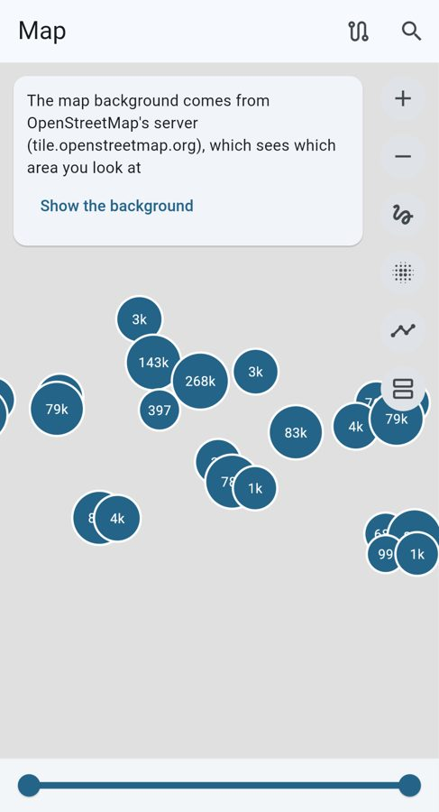
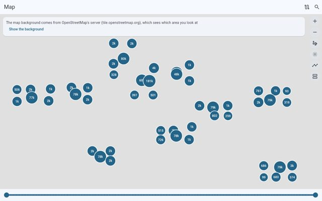

# ADR-0403 — The map is held to a budget: `map-pan` over the 1M library, on the gate's perf step

* **Status**: **Proposed — owner to confirm** (roadmap M1-45 "Map view with clustering and timeline integration").
* **Requirements**: F-11, NFR-PERF-1. **Design**: docs/14-maps-places-memories.md (not in this repository).

## Context

[ADR-0384](0384-map-view.md) built the map, and its pan was measured by hand (`app/benchmark/map_perf.dart`, "not a
budget") while the kernel's 1M test asserted wall-clock bounds a loaded runner can miss. The item's acceptance, "1M
geotagged assets cluster and pan smoothly on desktop and mid-range phones", therefore had no guard that fails when
a change slows the map.

## Decision

We will hold the map to the `map-pan` budget of `tools/perf/budgets.json`, measured by `tools/perf/run.sh` over the
`1m` fixture (about 733,000 located assets) with the real page and the kernel's index on its isolate:

* `janky` (max 1 %): the share of frames over 60 Hz while the camera sweeps the world, zooms into Berlin and pans at
  zooms 6, 10 and 14; a sweep over it is drawn again, three times at most, the least janky counting; headless counts
  build alone, as the other frame budgets do, because its raster thread is a software GPU.
* `query_p95` (max 16 ms, headless 25 ms): the p95 of the viewport queries meanwhile.
* `open` (max 5 s, headless 10 s): from opening the page to its first clusters.

The step is `perf/run.sh`, which CI already reports without failing on (`CHECK_ADVISORY`): the budget is advisory there,
fails locally and in the release train. `kernel/tests/cluster.rs` keeps its counts and only a 60 s hang guard.

Measured on this box (arm64, Xvfb, software GL), 1M library: janky 0 %, `query_p95` 6.3 ms, `open` 2.9 s; limited to
two cores (`taskset -c 0,1`): 0 %, 23 ms, 4.4 s, with raster p95 of 22 to 38 ms in software. In Chrome's Pixel 5
emulation (4x CPU throttle, 1.6 Mbit/s, 150 ms) over a million synthetic photos the page panned at 16.7 ms frames
(p95), 2 of 718 over 33 ms; in Firefox 5 of 608. An Android arm64 debug APK of the `play` flavor builds with the kernel.

 

## Consequences

A slower index, a heavier cluster layer or a build over the frame budget shows in the perf report of the next PR.
Phones are measured in the device lab (M10-02), as for every other budget.

## Options considered

* **Keep it by hand**: nothing would fail; rejected.
* **A blocking budget on hosted CI**: a 4-core runner is noisy; the owner's rule makes new measures advisory.
* **Assert the 16 ms query in the kernel test**: a wall-clock assertion in a correctness test; rejected.
